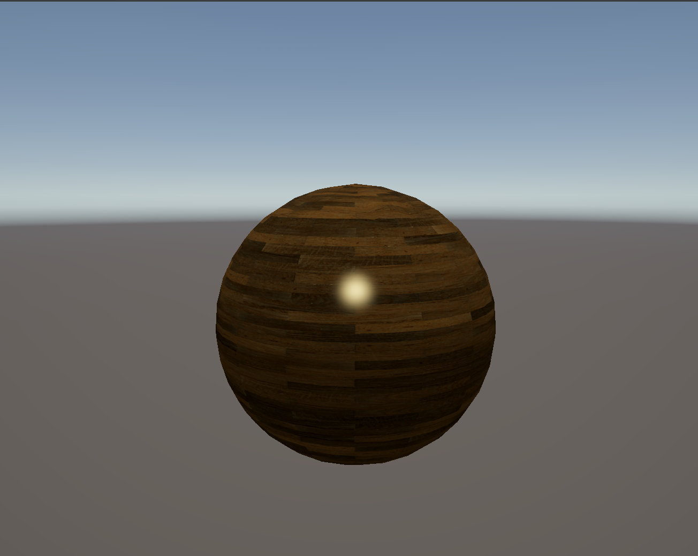

# Shader Showcase (In Progress)

## A showcase of a projected 8 different shaders each demonstrating an advanced lighting concept. 

Following alongside the open-source OpenGL website, I attempt to recreate each advanced lighting concept in a custom shader, to cement my understanding of each topic:
* Blinn-Phong + gamma correction ✓
* Shadows ← (here)
* _Normal Mapping_
* _Parallax Mapping_
* _HDR_
* _Bloom_
* _Deferred Shading_
* _SSAO_

All shaders created in Unity and written in HLSL. The goal for this project is to build upon the aforementioned knowledge to successfully recreate a PBR shader. 

# Images

   
  Fig 1. Blinn-Phong w/ gamma correction via sRGB texture

# References
* [LearnOpenGL: Advanced Lighting](https://learnopengl.com/Advanced-Lighting/Advanced-Lighting)
* [Writing a Basic Shader in Unity](https://medium.com/@onlyashley04/writing-a-basic-shader-in-unity-aa7396514daa)
* [Lighting & Shadows | Unity Shader Code Basics](https://youtu.be/bH--RU6qyTw?si=LASCXSS3GQNUpd9T)
